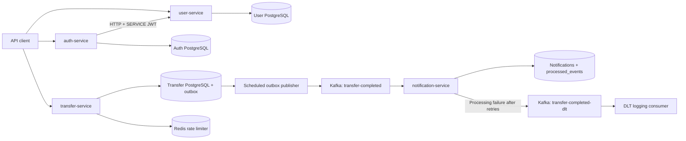

# TransferApp

A microservices-based money transfer backend built with Java and Spring Boot. Four independent services handle authentication, user profiles, accounts and transfers, and asynchronous notifications.

The architecture combines RSA-signed JWTs, service-to-service authentication, database transactions, pessimistic locking, request idempotency, Redis rate limiting, and reliable Kafka event delivery through a transactional outbox.

## Tech Stack

| Area | Technology |
| --- | --- |
| Language | Java 21 |
| Framework | Spring Boot 4.1.1, Spring MVC |
| Security | Spring Security, OAuth2 Resource Server, BCrypt, RSA / RS256 JWT |
| Persistence | PostgreSQL 17, Spring Data JPA / Hibernate |
| Database migrations | Flyway |
| Rate limiting | Redis, atomic Lua script |
| Messaging | Apache Kafka, Spring Kafka |
| Build | Maven Wrapper, one Maven project per service |
| Local infrastructure | Docker Compose |
| Tests | JUnit 5, Mockito, Spring Boot Test, MockMvc |

## Services and Architecture

| Service | HTTP Port | Database Port | Responsibility |
| --- | --- | --- | --- |
| `auth-service` | 8081 | 5433 | Registration, password authentication, JWT issuance |
| `user-service` | 8082 | 5434 | User profiles and internal profile provisioning |
| `transfer-service` | 8083 | 5435 | Accounts, deposits, transfers, history, idempotency, outbox |
| `notification-service` | 8084 | 5436 | Kafka consumption and notification persistence |

Redis is exposed on port `6379` and Kafka on port `9092`. Infrastructure ports are bound to localhost.



Each service owns its database. Accounts and transfers intentionally live together in `transfer-service` so both balance updates and the transfer record can be committed in one database transaction.

There is no API gateway yet. Clients call each service directly. Docker Compose starts infrastructure only; the Java services run separately.

## Implemented Features

- Email/password registration with normalized emails and BCrypt password hashing.
- Stateless RSA-signed JWT authentication, including signature, issuer, audience, and expiration validation.
- User UUID carried in the JWT subject and reused as the profile identity across services.
- Role-based access: `USER` for profile/account/transfer APIs and `SERVICE` for internal profile provisioning.
- Recoverable registration: failed profile provisioning can be retried with the same credentials and UUID. Login is blocked until provisioning completes, not until personal profile fields are filled in.
- Atomic, idempotent profile provisioning with PostgreSQL `ON CONFLICT DO NOTHING`.
- One account per user and currency, with support for `PLN`, `GBP`, `EUR`, and `USD`.
- Simulated deposits, same-currency transfers, ownership checks, and insufficient-balance validation.
- Pessimistic account locks for deposits and transfers. Transfers acquire both locks in deterministic UUID order to reduce deadlock risk.
- Paginated transfer history and sender/receiver access checks for individual transfers.
- Required `Idempotency-Key` for transfer creation, request hash checks, and replay of previous successful responses.
- Idempotency records with a 24-hour expiration timestamp and hourly bulk cleanup. Expiration takes effect when cleanup removes the record, not exactly at the timestamp.
- Redis-backed per-user transfer rate limiting: 10 requests per 60-second window. Redis failures intentionally allow requests through (fail-open).
- Transactional outbox: balance changes, transfer, idempotency linkage, and outgoing event are committed together.
- Scheduled outbox publication in batches of up to 50, with a default 5-second delay between runs. Failed sends remain pending for later publication.
- Consumer deduplication using `processed_events`, committed in the same transaction as sender and receiver notifications.
- Kafka processing retries with a 1-second backoff and 2 retries, followed by dead-letter publication. The DLT consumer currently logs failed events only.
- Flyway schema migrations, database constraints/indexes, request validation, and application exception handling.

Event delivery is **at least once**, not globally exactly once. If publication succeeds but recording publication fails, the same event may be sent again; consumer deduplication prevents duplicate notification writes for that event ID.

## Run Locally

### 1. Prerequisites

- JDK 21, with `JAVA_HOME` pointing to it.
- Docker with Docker Compose support.
- OpenSSL for generating a local RSA key pair.
- Maven, or the Maven Wrapper included in each service.
- An API client such as Postman.

The commands below use Maven. You can also run the same goals through the included Maven Wrapper or your IDE. Initial builds require internet access to download dependencies.

### 2. Configure Infrastructure

Create a local `.env` file in the repository root using `.env.example` as the template.

Replace the placeholder database passwords in `.env`. The current `.env.example` does not include notification database settings; add these entries to your local `.env` as well:

```dotenv
NOTIFICATION_DB_NAME=notification_db
NOTIFICATION_DB_USERNAME=notification_user
NOTIFICATION_DB_PASSWORD=replace_with_local_password
```

Keep the database names and usernames from the template unless you also override the corresponding Java datasource settings.

```text
docker compose up -d
docker compose ps
```

Wait for the infrastructure containers to become healthy. To inspect startup problems:

```text
docker compose logs --tail 100
```

PostgreSQL and Redis use named volumes. Changing credentials in `.env` does not change credentials inside an already initialized PostgreSQL volume. `docker compose down` preserves volumes; `docker compose down -v` deletes their data and should only be used for an intentional local reset.

### 3. Generate RSA Keys

Neither private nor public key files are committed. On a fresh clone, generate a private key and derive its matching public key from the repository root, then copy that public key to the services that verify tokens:

```text
openssl genpkey -algorithm RSA -pkeyopt rsa_keygen_bits:2048 -out auth-service/private-key.pem
openssl pkey -in auth-service/private-key.pem -pubout -out auth-service/public-key.pem
```

Copy the generated `auth-service/public-key.pem` to `user-service/public-key.pem` and `transfer-service/src/main/resources/public-key.pem`.

Do not overwrite an existing working key pair unless you intend to rotate it; tokens signed with the old key will no longer verify.

`auth-service` expects a PKCS#8 PEM private key (`BEGIN PRIVATE KEY`) and an X.509 SubjectPublicKeyInfo PEM public key (`BEGIN PUBLIC KEY`). The public key must match across all three JWT-aware services.

Default key locations:

| Service | Private Key | Public Key |
| --- | --- | --- |
| `auth-service` | `file:private-key.pem` | `file:public-key.pem` |
| `user-service` | Not required | `file:public-key.pem` |
| `transfer-service` | Not required | `classpath:public-key.pem` |

Run auth and user services with their own service directories as the working directory. You can override key locations with `JWT_PRIVATE_KEY` and `JWT_PUBLIC_KEY`, using Spring resource paths with the `file:` prefix and an absolute path.

### 4. Pass Configuration to Java

**Docker Compose reads `.env`; the Java applications do not automatically read it.** Configure the following environment variables for the Java service processes, using the same values as your local `.env`:

```dotenv
AUTH_DB_PASSWORD=your_local_auth_db_password
USER_DB_PASSWORD=your_local_user_db_password
TRANSFER_DB_PASSWORD=your_local_transfer_db_password
NOTIFICATION_DB_PASSWORD=your_local_notification_db_password
```

In IntelliJ, configure these variables under each service's Run Configuration and select JDK 21. The working directory should be that service's directory.

Additional optional overrides:

| Variable | Default |
| --- | --- |
| `AUTH_DB_URL` | `jdbc:postgresql://localhost:5433/auth_db` |
| `USER_DB_URL` | `jdbc:postgresql://localhost:5434/user_db` |
| `TRANSFER_DB_URL` | `jdbc:postgresql://localhost:5435/transfer_db` |
| `NOTIFICATION_DB_URL` | `jdbc:postgresql://localhost:5436/notification_db` |
| `REDIS_HOST` / `REDIS_PORT` | `localhost` / `6379` |
| `KAFKA_BOOTSTRAP_SERVERS` | `localhost:9092` |
| `USER_SERVICE_BASE_URL` | `http://localhost:8082` |
| `JWT_ISSUER` | `https://transferapp.local/auth-service` |
| `JWT_AUDIENCE` | `transferapp-api` |
| `JWT_EXPIRATION` | `15m` |
| `JWT_SERVICE_TOKEN_EXPIRATION` | `2m` |

Database usernames can also be overridden using each service's `*_DB_USERNAME` variable. Keep issuer and audience consistent across JWT-aware services.

### 5. Start the Services

Run the following command independently from each service's directory, with its environment variables configured:

```text
mvn spring-boot:run
```

Start `user-service` before testing registration, because auth calls it to provision the profile. Run all four services for the complete transfer and notification flow.

Flyway applies migrations at startup. Hibernate uses `ddl-auto=validate`; it validates the resulting schema rather than creating tables.

Health checks are available at `http://localhost:<port>/actuator/health` for ports `8081` through `8084`.

## API Overview

Protected client requests use `Authorization: Bearer <accessToken>`. IDs are UUIDs. The current user's identity comes from the verified JWT subject, not a client-supplied user ID.

| Service | Method | Endpoint | Purpose / Access |
| --- | --- | --- | --- |
| Auth | POST | `/auth/register` | Register and provision a profile; public |
| Auth | POST | `/auth/login` | Authenticate and obtain a JWT; public |
| User | GET | `/users/me` | Read current profile; USER |
| User | PUT | `/users/me` | Update current profile; USER |
| User | PUT | `/internal/user-profiles/{userId}` | Ensure profile exists; SERVICE |
| Transfer | POST | `/accounts` | Create an account; USER |
| Transfer | GET | `/accounts` | List own accounts; USER |
| Transfer | POST | `/accounts/{accountId}/deposit` | Simulated deposit into own account; USER |
| Transfer | POST | `/transfers` | Create or replay a transfer; USER + Idempotency-Key |
| Transfer | GET | `/transfers?page=0&size=20` | Own sent/received history; USER |
| Transfer | GET | `/transfers/{transferId}` | Read a transfer as sender or receiver; USER |

History defaults to 20 entries per page, with a maximum requested page size of 100. The service uses its repository-defined history ordering rather than arbitrary client sorting.

`notification-service` currently has no notification listing API or email delivery integration. It persists notifications from Kafka events.

### Example: Register and Login

```http
POST http://localhost:8081/auth/register
Content-Type: application/json

{
  "email": "alice@example.com",
  "password": "ExamplePass123!"
}
```

```http
POST http://localhost:8081/auth/login
Content-Type: application/json

{
  "email": "alice@example.com",
  "password": "ExamplePass123!"
}
```

Registration passwords must contain 12-24 characters. Login returns `accessToken`, `tokenType`, and `expiresIn` in seconds. A newly provisioned profile starts as `INCOMPLETE`; the user can log in and update it through `PUT /users/me`.

### Example: Create an Account and Deposit

```http
POST http://localhost:8083/accounts
Authorization: Bearer <accessToken>
Content-Type: application/json

{
  "currency": "EUR"
}
```

Use the returned account `id` for the deposit:

```http
POST http://localhost:8083/accounts/<accountId>/deposit
Authorization: Bearer <accessToken>
Content-Type: application/json

{
  "amount": 500.00
}
```

### Example: Transfer Between Two Users

Register and log in as a second user, create another EUR account, and take its `accountNumber` from the response. Then use the first user's token and source account:

```http
POST http://localhost:8083/transfers
Authorization: Bearer <firstUsersAccessToken>
Idempotency-Key: <uniqueRequestKey>
Content-Type: application/json

{
  "sourceAccountId": "<firstUsersEurAccountId>",
  "targetAccountNumber": "<secondUsersEurAccountNumber>",
  "amount": 100.00
}
```

The successful transfer returns `201 Created` with status `COMPLETED`. In this example, balances change from `500 -> 400` and `0 -> 100`. Notification processing is asynchronous and may happen after the HTTP response.

Keep the same idempotency key and body when retrying the same operation; generate a new key for a new operation. A replay currently also returns `201`. Keys are scoped per user, must be nonblank, and have a maximum length of 100 characters. Reusing a retained key for a different request returns `409`. Replays pass through the rate limiter too.

Typical error responses include `400` for invalid input/self-transfer, `401` for missing or invalid authentication, `403` for role/ownership violations, `404` for missing resources, `409` for conflicts, `422` for insufficient balance/currency mismatch, and `429` for rate limiting.

## Important Flows

**Registration:** normalized email and hashed password -> pending auth record -> SERVICE JWT -> internal profile PUT -> atomic profile insert or existing profile -> mark registration completed -> response. If provisioning fails, repeat registration with the same credentials to resume it; this is recovery logic, not a distributed transaction.

**Transfer:** authenticate JWT -> rate limit -> prepare/replay idempotency -> resolve accounts -> lock in UUID order -> validate ownership/currency/balance -> update balances -> save completed transfer and outbox event -> attach transfer to idempotency record -> commit -> response.

**Notification:** scheduled publisher -> Kafka `transfer-completed` -> consumer -> transaction containing processed-event marker and two notifications -> commit. Retryable processing failures roll back those writes, then retry twice before publishing to `transfer-completed-dlt`; its consumer logs the event.

## Tests

From **each service directory**, with the environment variables and RSA keys configured:

```text
mvn test
```

There is no root Maven aggregator, so run this command independently in all four services. Some tests use real PostgreSQL, Redis, or Kafka through the local configuration; keep Docker infrastructure running. Integration tests can write to local databases and Kafka topics. Use disposable local data, not a shared or production environment.

The suites include authentication/JWT validation, controller security, profile provisioning concurrency, registration recovery, transfer/idempotency behavior, outbox transaction rollback, successful Kafka publication, and a broker-unavailable publication case. Tests are not an exhaustive production reliability guarantee.

## Repository Layout

```text
MoneyTransferApplication/
|-- auth-service/          # Credentials, registration, login, JWT signing
|-- user-service/          # Profiles and internal provisioning
|-- transfer-service/      # Accounts, transfers, Redis, idempotency, outbox
|-- notification-service/  # Kafka consumers, notification storage, DLT
|-- compose.yml            # Local infrastructure only
|-- .env.example           # Local configuration template
`-- README.md
```

Each service contains its own `pom.xml`, Maven Wrapper, Java sources, tests, and `src/main/resources/db/migration` directory.

## Scope and Next Steps

- API gateway is not implemented yet.
- Postman is used to interact with and test the APIs instead of a frontend application.
- Real payment integration, FX conversion, refresh-token flow, and notification delivery channels are not implemented.
- The outbox publisher is designed for the current local setup; multi-instance publisher coordination is not implemented.
- Infrastructure uses single-node Kafka and a single-partition main/DLT topic, not a highly available deployment.
- Production secret management, key rotation, monitoring, and deployment hardening are outside the current project scope.

